<div align="center">

# 🐾 PawJoy: AI-Generated Product Advertisement

**Happy Pets, Happy Homes**

A complete 1:52 video advertisement for a pet-care brand, from brand identity and product design to the final edited commercial, created end to end with generative AI.


<a href="video/pawjoy-ad-preview.mp4">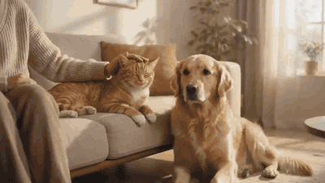</a>

**[▶ Watch the full ad (1440p, 30 MB)](video/pawjoy-ad-full.mp4)** · **[▶ Web preview (720p, 9 MB)](video/pawjoy-ad-preview.mp4)**

</div>

---

## Overview

| | |
|---|---|
| **Type** | Product video advertisement (AI-generated) |
| **Brand** | PawJoy: premium food, toys, grooming and beds for cats and dogs |
| **Length** | 1 min 52 s · 2560×1440 · 30 fps |
| **Languages** | English, with a bilingual English / Egyptian Arabic call to action |
| **Role** | Concept, art direction, prompt engineering, generation, editing |

The goal was to show that a small brand can get a polished, TV-style commercial without a film crew, studio or real product photography. Every visual here, including the brand, the packaging, the pets and the home, was generated with AI and then assembled into a single story.

---

## The Product Line

Before any video was made, the brand and its products were designed as still images. These became the visual references that keep the packaging, colours and pets consistent from shot to shot.

<p align="center">
  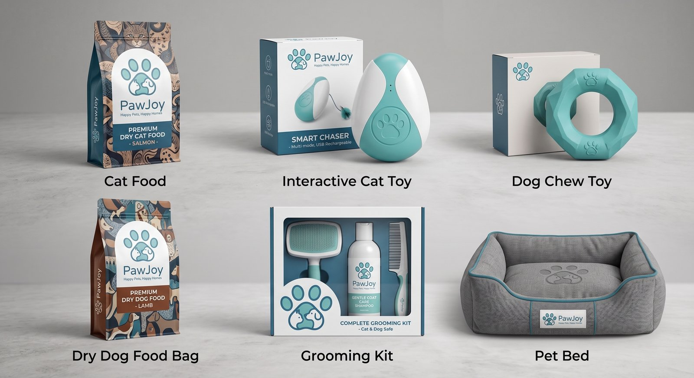
</p>

| Cat Food | Dog Food | Interactive Cat Toy |
|:---:|:---:|:---:|
| 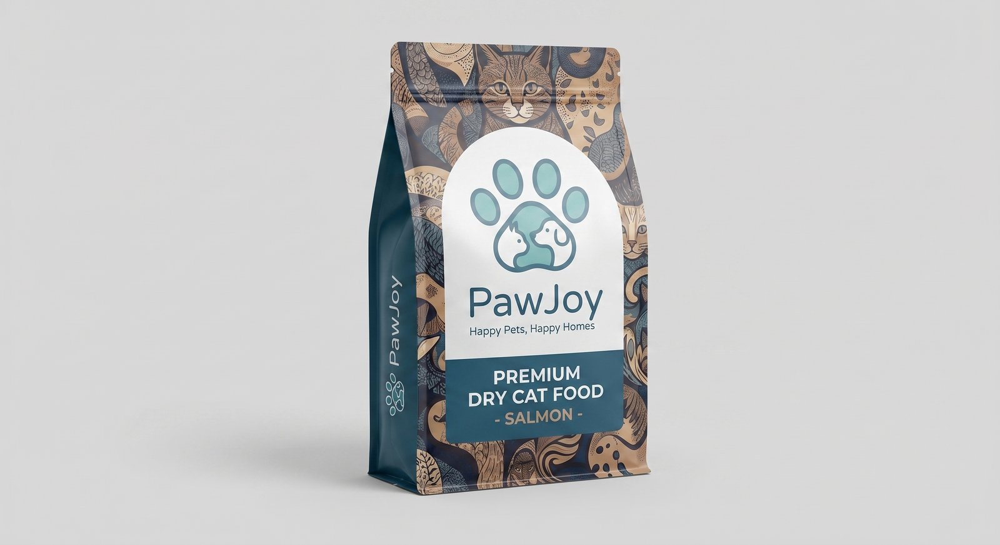 | 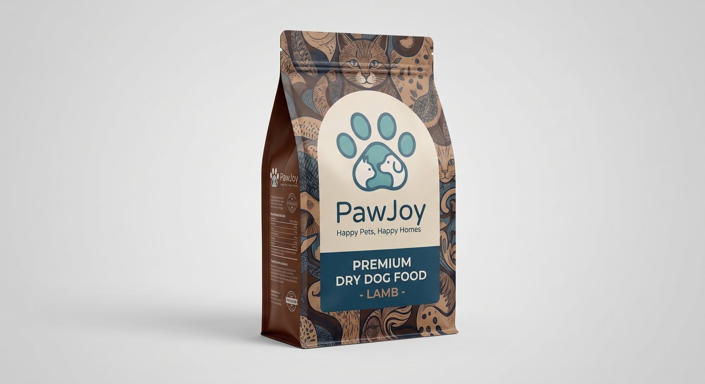 | 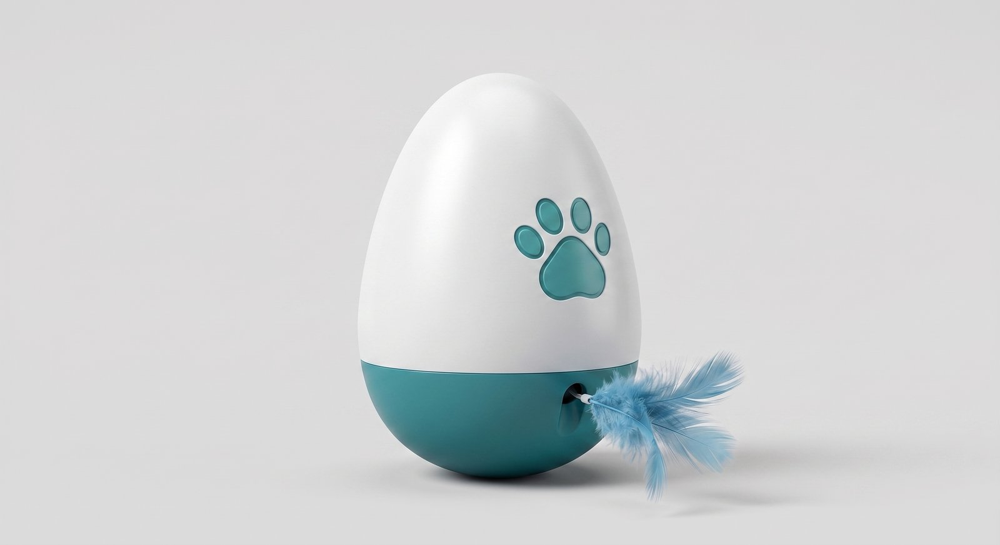 |
| **Dog Chew Toy** | **Grooming Kit** | **Pet Bed** |
| 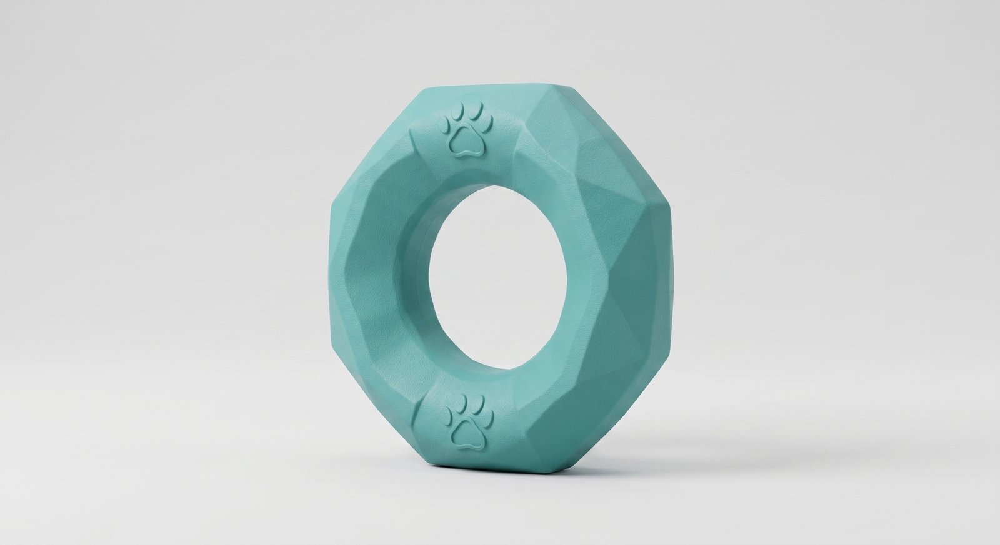 | 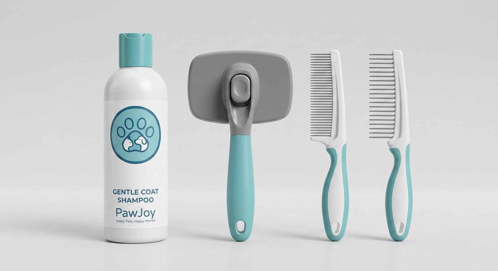 | 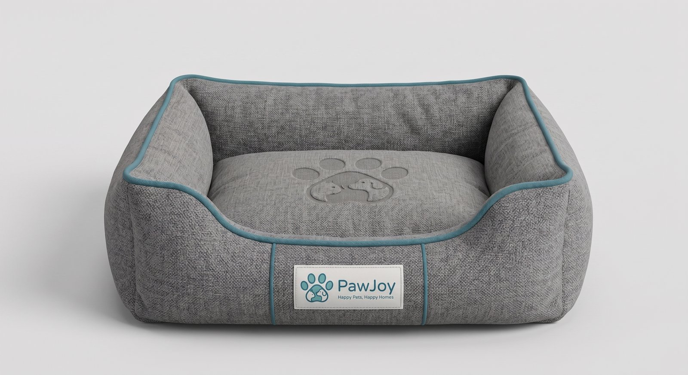 |

### The Stars

The same two characters appear in every scene. Their studio reference shots were generated first so the model could keep them consistent.

| Ginger Tabby Cat | Golden Retriever |
|:---:|:---:|
| 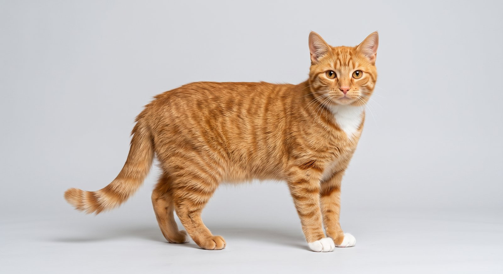 | 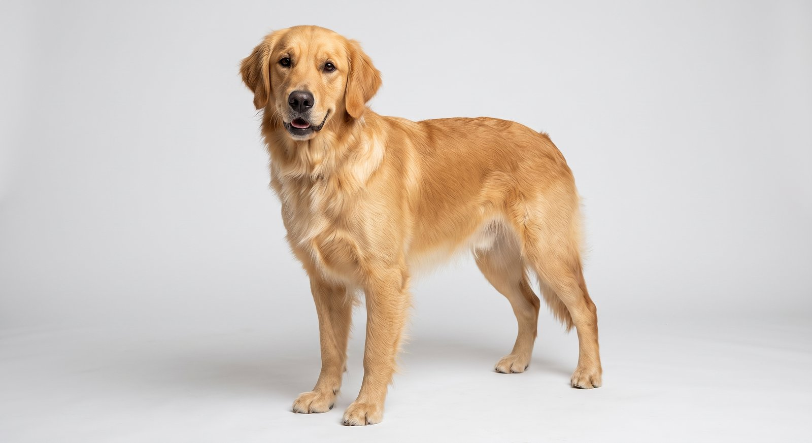 |

---

## Workflow

```
 1. Brand & concept          2. Product design            3. Character references
 ─────────────────           ─────────────────            ───────────────────────
 Name, slogan, palette  ──►  Packaging & products    ──►  Cat & dog on studio
 (teal · white · warm        with Nano Banana             background for
  earth tones)               (Gemini image model)         consistency
                                                                 │
                                                                 ▼
 6. Delivery                 5. Edit & sound              4. Scene generation
 ─────────────               ───────────────              ───────────────────
 Full-res master +      ◄──  CapCut / Premiere Pro:  ◄──  Google Veo: each scene
 web-optimised cuts          sequencing, pacing,          animated from the
                             music, transitions,          product + character
                             bilingual end card           references
```

**Tools**

| Stage | Tool |
|---|---|
| Ideation, script and prompt writing | Google Gemini |
| Brand, packaging, products and characters | Nano Banana (Gemini image generation) |
| Video scenes | Google Veo |
| Editing, music, transitions, end card | CapCut and Adobe Premiere Pro |

---

## Storyboard

| Time | Scene |
|---|---|
| 0:00 | **Opening:** the cat and dog relax with their owner on a sunlit sofa |
| 0:12 | **Product reveal:** the full PawJoy range in the living room |
| 0:20 | **Cat food:** the cat walks up to its bowl beside the salmon cat-food bag |
| 0:32 | **Dog food:** the retriever eats next to the lamb dog-food bag |
| 0:40 | **Interactive cat toy:** the cat plays with the Smart Chaser |
| 0:52 | **Dog chew toy:** the retriever plays with the teal chew ring |
| 1:00 | **Pet bed:** the dog settles into the PawJoy bed |
| 1:12 | **Grooming kit:** the owner brushes the dog's coat |
| 1:20 | **Full range:** every product together in the home |
| 1:32 | **Family moment:** owner, cat and dog together on the sofa |
| 1:48 | **End card:** logo, slogan and *Order Now · اطلب دلوقتي* |

<p align="center">
  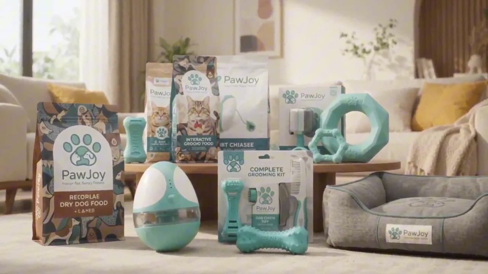
  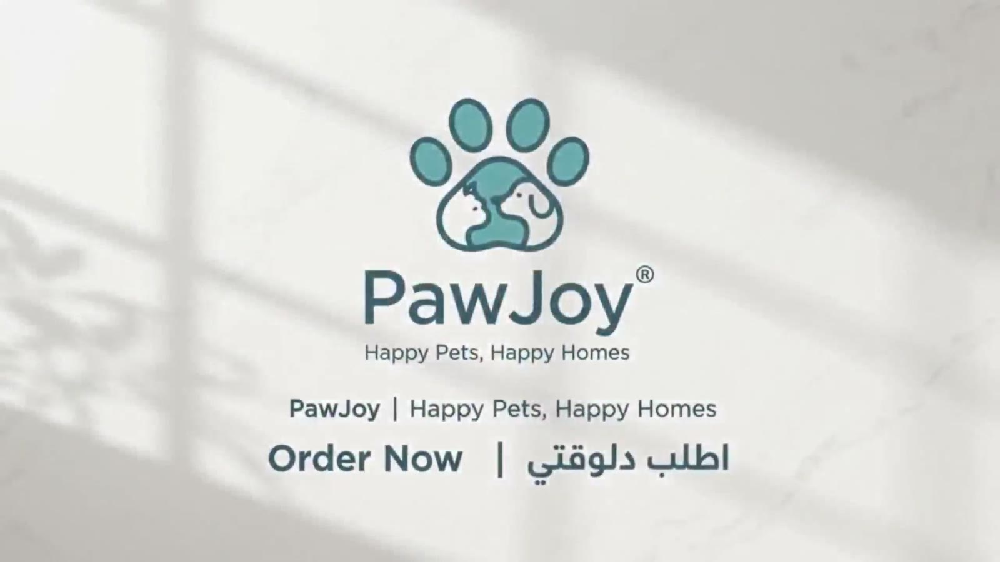
</p>

---

## What This Project Shows

- **Brand consistency across AI shots:** the same packaging design, teal palette and two pets hold together over 11 scenes, using still references before animating.
- **Story-first editing:** each product gets its own moment, then the ad closes on the whole family and a clear call to action.
- **Localisation:** the bilingual end card targets an Egyptian audience.
- **Speed and cost:** a full commercial produced by one person with no filming, props or product samples.

---

## Repository Structure

```
pawjoy-ai-video-ad/
├── README.md
├── video/
│   ├── pawjoy-ad-full.mp4       # master, 2560×1440
│   └── pawjoy-ad-preview.mp4    # 1280×720, web preview
├── images/                      # product, packaging and character stills (1600 px)
└── assets/                      # preview GIF, cover and end-card frames
```

---

## Notes

PawJoy is a fictional brand created for this project. All products, packaging, animals, people and settings are AI-generated.

---

## Author

**Michael Magdy**

- Portfolio: [michaelmagdy.lovable.app](https://michaelmagdy.lovable.app/)
- GitHub: [@michaelmagdyda](https://github.com/michaelmagdyda)

Available for AI video ads, product visuals and brand content. Feel free to reach out.
